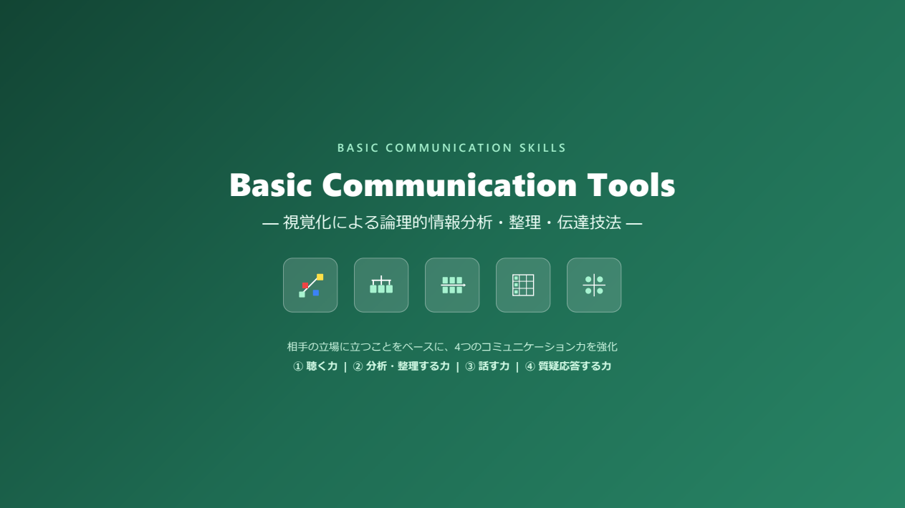
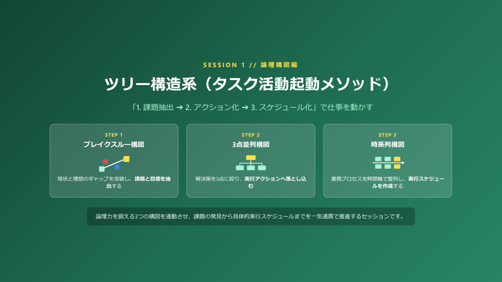
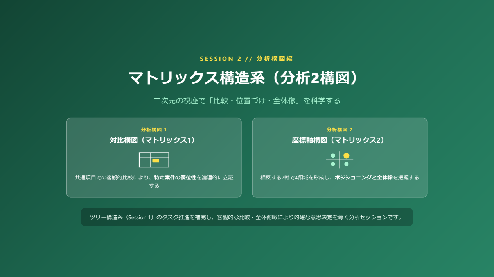

# basic-communication-tools (BCT)

> **視覚化による論理的情報分析・整理・伝達技法**  
> 「相手の立場に立つ」を起点に、課題解決・合意形成・タスク推進を加速させるビジュアルフレームワーク集


-orange?style=flat-square)


---

## 📌 概要 (Overview)

### 開発の背景と目的
ビジネスの現場において、「言いたいことが相手に伝わらない」「資料に文字を詰め込みすぎて要点がぼやける」「合意形成に時間がかかりタスクが進まない」という課題は後を絶ちません。その根本的な原因は、自己中心的な「伝えたつもり」に陥り、情報が構造化されていない点にあります。

**`basic-communication-tools`（BCT）** は、**「主格を相手に置く」** 思考様式を基盤とし、情報を論理的・構造的に整理・視覚化して、相手の確実な理解と迅速な意思決定を引き出すための実践的フレームワーク集です。

### 思考と伝達を支える2大体系
単なるスライド作図のテクニックではなく、**「思考の整理」から「実務の実行」までを直結させるメソッド**として体系化されています。

1. **ツリー構造系（論理3構図） — タスク活動起動メソッド**  
   業務やプロジェクトを立ち上げる際の一連の実行サイクル：  
   `【Step 1: 課題抽出】ブレイクスルー構図` ➔ `【Step 2: アクション化】3点並列構図` ➔ `【Step 3: スケジュール化】時系列構図`
2. **マトリックス構造系（分析2構図） — 意思決定・状況把握メソッド**  
   二次元の視座で客観的な事実や位置づけを可視化する体系：  
   `【分析構図 1】対比構図（優位性の立証）` ＆ `【分析構図 2】座標軸構図（ポジショニングと全体像）`

### 想定される活用シーン
- **新規企画・改善提案**: 現状の課題と目指すべき理想のギャップを明快に示し、提案を通す
- **進捗報告・タスク管理**: 業務アクションの切り口を揃え、時系列で遅延や因果関係を共有する
- **複数案の比較検討**: 評価軸を統一したマトリックスにより、客観的な優位性を立証する
- **組織内ファシリテーション**: 議論の空中戦を防ぎ、チームの共通言語として合意形成を迅速化する

本リポジトリでは、ブラウザで即座に上映できる **インタラクティブHTMLスライド（全22枚）** と、そのまま印刷・配布できる **ベクター品質PDF** を完全な形で提供しています。



---

## 🚀 特徴 (Key Features)

- **完全スタンドアロン（ゼロ依存）**  
  外部CDN、重いJSライブラリ、Webフォントを一切使用せず、純粋な HTML5 / CSS3 / SVG / JavaScript のみで実装。ローカルや社内オフライン環境でも100%正確にレンダリングされます。
- **直感的なプレゼンテーション操作**  
  矢印キー（`←` / `→`）やスペースキー、画面下部のプログレスバーによる軽快なスライド操作に対応。
- **一覧切替モード搭載**  
  右上の「一覧切替」ボタンにより、全22スライドのサムネイルをグリッド俯瞰可能。アジェンダ確認や質問対応時のクイックジャンプに最適です。
- **印刷・PDF出力最適化**  
  CSS `@media print` ルールを緻密に調整。ブラウザの印刷ダイアログからA4横・16:9比率のベクターPDFを劣化なく直接出力できます。

---

## 📑 スライド構成 (Architecture)

全22スライドは、導入から実践・総括まで論理的な流れで設計されています。

```text
basic-communication-tools (全22スライド)
 ├── [導入] 表紙・2大体系・基本5構図の俯瞰 (Slides 1〜3)
 ├── 【SESSION 1】 ツリー構造系：タスク活動起動メソッド (Slides 4〜13)
 │    ├── Step 1: 課題・目標の抽出「ブレイクスルー構図」 (Slides 5〜7)
 │    ├── Step 2: アクション化「3点並列構図」 (Slides 8〜11)
 │    └── Step 3: スケジュール化「時系列構図」 (Slides 12〜13)
 ├── 【SESSION 2】 マトリックス構造系：分析2構図 (Slides 14〜17)
 │    ├── 分析構図 1: 優位性の立証「対比構図」 (Slides 15〜16)
 │    └── 分析構図 2: 全体像の可視化「座標軸構図」 (Slide 17)
 ├── 【実践編】 プレゼンテーション＆デリバリー技法 (Slides 18〜21)
 └── 【結び】 SUMMARY // 学習内容のまとめ (Slide 22)
```

### セッション中扉プレビュー

| SESSION 1 // 論理構図編（ツリー構造系） | SESSION 2 // 分析構図編（マトリックス構造系） |
| :---: | :---: |
|  |  |

---

## 🖥️ 閲覧・利用方法 (Usage)

### 1. Webブラウザで閲覧（ローカル）
リポジトリをクローンまたはダウンロード後、ブラウザで直接開くだけでプレゼンテーションが開始できます。

```bash
git clone https://github.com/<ユーザー名>/basic-communication-tools.git
cd basic-communication-tools
```

ファイル一覧から `index.html` または `slide.html` をダブルクリックして開いてください。

#### 操作キー一覧
| 操作 | キー / アクション |
| :--- | :--- |
| 次のスライドへ | `→` / `Space` / `PageDown` / ナビゲーション `❯` ボタン |
| 前のスライドへ | `←` / `PageUp` / ナビゲーション `❮` ボタン |
| 全スライド一覧切替 | 右上「一覧切替」ボタン |
| PDF印刷 | 右上「PDF印刷」ボタン または `Ctrl + P` (`Cmd + P`) |

### 2. GitHub Pages でオンライン公開
本リポジトリはルートディレクトリに `index.html` を備えているため、GitHub Pagesを有効化するだけで即座にWeb上で公開・共有可能です。

1. GitHub リポジトリの **Settings** ➔ **Pages** を開く
2. **Build and deployment** の Source で **Deploy from a branch** を選択
3. Branch を `main`（または `master`）、フォルダを `/ (root)` に設定して **Save**
4. 数十秒で以下のURLにてスライドが世界中に公開されます：  
   `https://<ユーザー名>.github.io/basic-communication-tools/`

### 3. PDFのダウンロード・印刷
印刷やオフライン配布には、リポジトリに含まれる以下のPDFファイルを直接ご利用いただけます。
- [`Basic_Communication_Tools_Slides.pdf`](Basic_Communication_Tools_Slides.pdf)（全22ページ・高解像度ベクター版）

---

## 📂 ファイル構成 (Repository Structure)

```text
basic-communication-tools/
├── index.html                           # GitHub Pages用エントリポイント（スライド本体）
├── slide.html                           # スライド本体（HTML5）
├── Basic_Communication_Tools_Slides.pdf # 完成版スライドPDF（全22ページ）
├── Basic Communication Tools.txt        # 原文テキストデータ
├── assets/                              # README用プレビュー画像
│   ├── cover.png
│   ├── session1.png
│   └── session2.png
├── .gitignore                           # Git除外設定（バックアップ・中間生成物）
└── README.md                            # 本ドキュメント
```

---

## 💡 コアメッセージ (Core Philosophy)

1. **主格を相手に置く**  
   自己満足の報告を脱し、常に「相手がどう判断・行動するか」を起点に情報を設計する。
2. **タスク活動の3連環**  
   「現状と理想のギャップ（課題）」を突破し、「3点のアクション」に絞り込み、「時間軸」で整列して実行に移す。
3. **訴求ポイントと4ルール**  
   相手のメリットを提示し、自立性（主格統一・形容詞排除）と等階層性（基準統一）を担保する。
4. **プレゼンターが主役**  
   スライド（第一次情報・視覚）、語り（第二次情報・聴覚）、配布資料（第三次情報・詳細）の三位一体で聴き手を導く。
